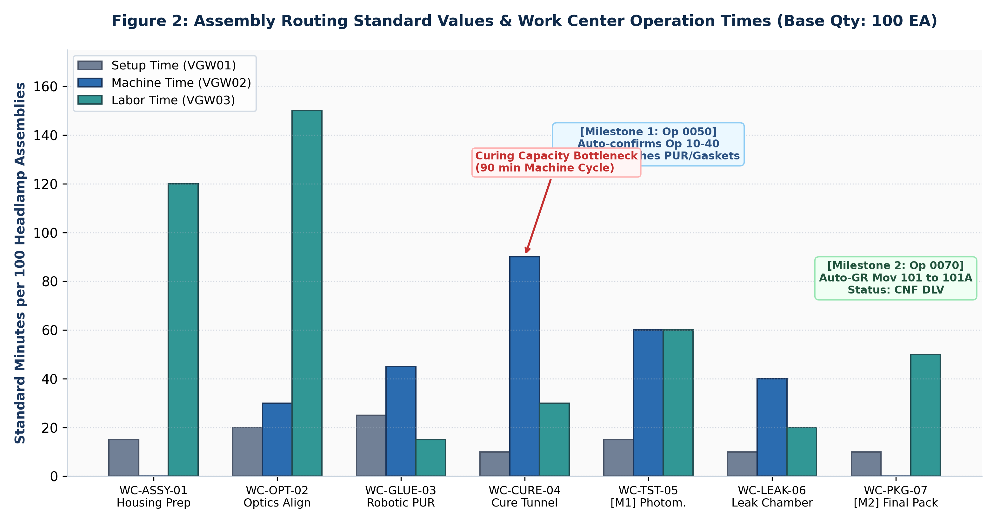
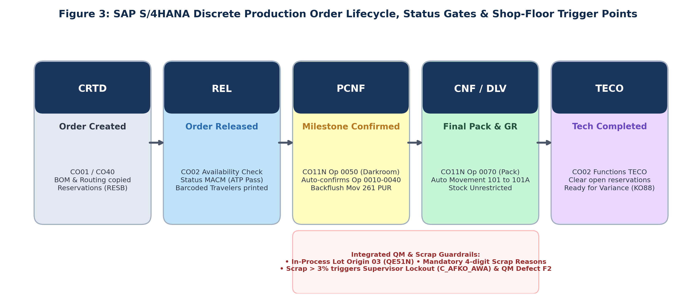
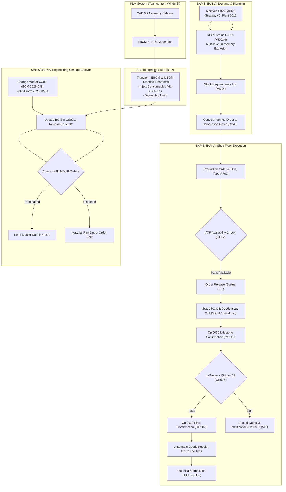
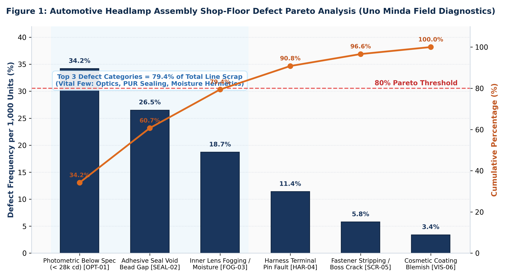
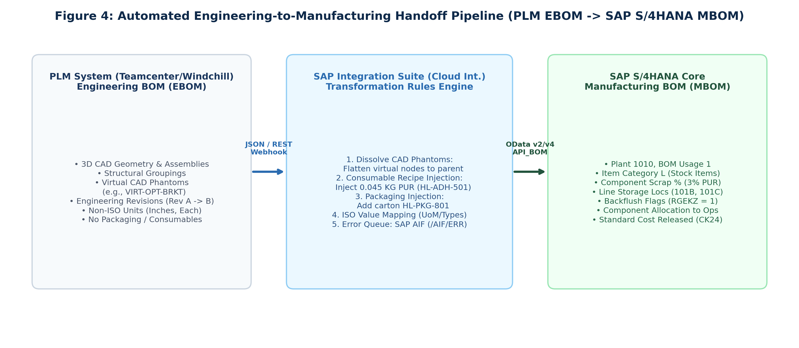

# SAP S/4HANA Manufacturing & PLM Coverage Project
> **"From Shop Floor to SAP":** A consultant-grade requirements documentation, business process mapping, and data architecture portfolio for discrete manufacturing in SAP S/4HANA.

---

## Executive Metadata

- **Author / Candidate:** Adarsh
- **Target Roles:** SAP Functional Consultant (PP / QM / PLM), Manufacturing Business Analyst, ERP Solutions Specialist
- **Status:** Complete Baseline Release v1.0 | **Date:** November 2026
- **Reference System:** SAP S/4HANA 2023 / Cloud Private Edition
- **Manufacturing Domain:** Discrete Automotive Lighting Assembly (Plant `1010`)
- **Key Artifacts:** 1 BSD, 1 FRD, 7 Process Flows, 20 User Stories, 25 Test Scripts, 57 Data Mapping Fields, 1 Defect Pareto FS, 1 Client Workshop Agenda, 1 Excel Workbook, 1 Standalone PDF Briefing Paper, 4 Engineering Figures.

---

## 1. Problem Statement & Portfolio Objective

Hiring managers and screening teams evaluating candidates for SAP Manufacturing (PP / QM / PLM) functional consulting positions look for tangible proof of core consulting deliverables:
- Business process mapping (**As-Is** vs. **To-Be**).
- Authoring **Business Scenario Documents (BSDs)** and **Functional Requirements Documents (FRDs)**.
- Writing granular **Agile User Stories** with formal *Given/When/Then* acceptance criteria.
- Formulating **Master Data Mapping Specifications** and **Interface Specifications**.
- Constructing **Quality Assurance Test Plans** and executing traceable **Test Scripts**.

While my professional background includes intensive physical shop-floor diagnostics at **Uno Minda** (automotive lighting assembly analysis) and engineering process mapping at **Technip Energies**, this self-initiated portfolio project closes the qualification gap honestly and definitively.

> **Professional Ethics & Non-Disclosure Notice:**  
> All part numbers, bills of material, work centers, operational cycle times, and defect statistics in this repository are **100% synthetic and generalized**. No proprietary or confidential employer data is used. This project demonstrates functional consulting rigor; it does not claim unearned client implementation or certification credentials.

---

## 2. Discrete Manufacturing Use Case: Automotive Bi-LED Headlamp (`HL-200X`)

The project models the end-to-end discrete manufacturing lifecycle in Plant `1010` for an automotive **Bi-LED Headlamp Assembly (`HL-200X`)**:

```
                              [HL-200X Bi-LED Headlamp Assembly]
                                              |
      +-------------------+-------------------+-------------------+-------------------+
      |                   |                   |                   |                   |
[HL-HOU-101]        [HL-LENS-201]       [HL-PCB-301]        [HL-HAR-401]        [HL-ADH-501]
Composite Housing   Projector Lens      Bi-LED Driver &     Waterproof 6-Pin    Automotive 2K PUR
Sub-Assembly        Module (PC Anti-    Die-Cast Heat Sink  Sealed Wire         Structural
(PP-T40)            Fog Coated)         (Serialized)        Harness             Adhesive Sealant
```

### The 7-Station Assembly Routing & Standard Operation Times

The production line comprises 7 specialized work centers configured in S/4HANA (Standard Value Key `SAP1`):




### Engineering Routing Analysis:
- **Bottleneck Identification:** Robotic dispensing cell `WC-GLUE-03` and thermal curing tunnel `WC-CURE-04` represent the primary machine cycle constraints (45 min and 90 min per 100 units). Finite capacity scheduling in S/4HANA levels these work centers to prevent assembly line starvation.
- **Milestone 1 (Op 0050):** Photometric Darkroom Inspection functions as the first milestone gate. Confirming this operation in `CO11N` automatically confirms preceding mechanical and gluing operations (0010 to 0040) and executes backflush postings (Movement `261`) for structural adhesive (`HL-ADH-501`).
- **Milestone 2 (Op 0070):** Packaging confirmation automatically executes Goods Receipt (Movement `101`), depositing finished units into Storage Location `101A` under status `DLV`.

---

## 3. End-to-End Solution Architecture & Order Lifecycle

The discrete manufacturing architecture links customer demand forecasting, in-memory MRP Live, shop floor order execution, quality inspection points, and engineering change management:





### Operational Highlights:
1. **Demand & In-Memory MRP Live (`MD01N`):** Monthly Planned Independent Requirements (PIRs) under Planning Strategy `40` are consumed by incoming sales schedules. In-memory MRP Live calculates net requirements across multi-level BOMs in seconds, eliminating classic MRP batch delays.
2. **Dynamic Available-to-Promise (ATP):** Orders in status `CRTD` cannot transition to `REL` if high-value components (e.g. Bi-LED driver module `HL-PCB-301`) are missing. S/4HANA flags status `MSPT` (Missing Part), preventing line-side downtime.
3. **Milestone Execution & Serialized Staging:** High-value serialized LED modules are issued manually via `MIGO` (Movement `261`) with serial number registration (`EQUI`/`OBJK`), while C-parts and adhesives are consumed via automated backflush upon milestone confirmation.

---

## 4. Shop-Floor Defect Diagnostics & Quality Intelligence (Uno Minda Field Diagnostics)

Reflecting real-world assembly line quality failure modes from automotive lighting manufacturing, defects compound rapidly if systemic issues are not recognized and mitigated within the shift:



### Quality Analysis & S/4HANA Functional Guardrails:
- **The "Vital Few" (79.4% Cumulative Scrap):**
  1. `DEF-OPT-01` (Photometric Intensity Failure, 34.2%): Caused by LED driver thermal throttling or micro-misalignment of the projector lens bracket.
  2. `DEF-SEAL-02` (Adhesive Sealant Void, 26.5%): Robotic nozzle dispensing pressure drop resulting in an incomplete polyurethane perimeter bead.
  3. `DEF-FOG-03` (Polycarbonate Lens Fogging, 18.7%): Microscopic moisture ingress detected during differential pressure decay testing.
- **Mandatory Scrap Reason Codes:** Confirmation screen `CO11N` enforces mandatory selection of a 4-digit reason code (e.g. `0102` Seal Void). Submitting scrap without a reason code generates Error `RU 054: Enter a reason for variance`.
- **Automated Supervisor Scrap Lockout (> 3.0%):** If operation scrap exceeds 3% of batch volume, confirmation save is blocked unless authorized under object `C_AFKO_AWA` (Plant Production Supervisor). S/4HANA automatically triggers an internal QM Defect Notification (Type `F2`).
- **In-Process QM Lot Synchronization:** Operations 0050 and 0060 link to In-Process Inspection Lots (Origin `03`). Rejection under Usage Decision (`QA11`) automatically transfers stock to Blocked Stock `101Q` (Movement `350`) or initiates a controlled Rework Order (`CO07`).

---

## 5. Automated PLM-to-ERP Engineering Handoff Pipeline

In discrete manufacturing, product design originates in CAD/PLM (Siemens Teamcenter, PTC Windchill, Dassault 3DEXPERIENCE), while procurement and shop floor assembly are governed in SAP S/4HANA. An event-driven interface via **SAP Integration Suite** synchronizes these systems:



### Key Transformation Mechanics:
1. **CAD Phantom Dissolution:** Virtual CAD sub-assemblies (e.g. `VIRT-OPT-BRKT`) that exist only for 3D modeling grouping are flattened; child parts are reattached directly to parent assembly `HL-200X`.
2. **Recipe & Consumable Injection:** CAD models do not include bulk chemicals or tape. Middleware mapping rules inject 0.045 KG of 2K PUR structural adhesive (`HL-ADH-501`) and shipping carton `HL-PKG-801` into the S/4HANA Manufacturing BOM.
3. **ISO Unit of Measure Mapping:** Converts CAD unit strings (`Inches`, `each`) into ISO-compliant SAP codes (`INH`, `EA`).
4. **Exception Dead-Letter Queue (AIF):** Payloads containing missing material master numbers or invalid units trigger an HTTP `422 Unprocessable Entity` and are routed to SAP Application Interface Framework (`/AIF/ERR`). Data stewards can reprocess corrected messages with zero data loss.

---

## 6. Repository Directory Structure & Artifact Index

```
SAP/
├── README.md                                          <- Master portfolio overview & interview guide
├── SAP Manufacturing Coverage Project PRD.md          <- Original foundational PRD
├── docs/
│   ├── 00_EXECUTIVE_SUMMARY.md                        <- Standalone executive briefing paper
│   ├── SAP_Manufacturing_Coverage_Executive_Summary.pdf <- Humanly curated 4-page PDF briefing with embedded figures
│   ├── images/                                        <- High-resolution engineering figures
│   │   ├── fig1_defect_pareto_analysis.png            <- Shop floor defect Pareto chart (80/20 rule)
│   │   ├── fig2_assembly_station_cycle_times.png      <- Work center cycle times & capacity bottleneck
│   │   ├── fig3_s4hana_order_lifecycle.png            <- S/4HANA order lifecycle & status gates
│   │   └── fig4_plm_ebom_to_mbom_pipeline.png         <- PLM EBOM-to-MBOM integration architecture
│   ├── 01_SCENARIO_FLOWS/                             <- 7 Detailed As-Is vs To-Be Scenario Flows
│   │   ├── README.md                                  <- Scenario index & architectural principles
│   │   ├── SC-01_Product_and_BOM_Definition.md        <- Master data, BOM hierarchy & recursion error
│   │   ├── SC-02_Routings_and_Work_Centers.md         <- Capacities, standard values & activity rates
│   │   ├── SC-03_Demand_to_Production_Plan.md         <- PIRs, Strategy 40, MRP Live & shortages
│   │   ├── SC-04_Production_Order_Execution_and_Confirmation.md <- Order lifecycle, ATP, milestones, scrap
│   │   ├── SC-05_Quality_Inspection_and_Defect_Handling.md      <- Lot 03, lux/leak testing, defects, UD
│   │   ├── SC-06_Engineering_Change_to_Production.md  <- ECM Change Master, validity dates & WIP cutover
│   │   └── SC-07_PLM_to_ERP_Integration.md            <- EBOM to MBOM, CAD phantoms & AIF error queue
│   ├── 02_BUSINESS_SCENARIO_DOCUMENT/
│   │   └── Business_Scenario_Document_BSD.md          <- Comprehensive BSD covering Scenarios 3, 4, 6
│   ├── 03_FUNCTIONAL_REQUIREMENTS/
│   │   └── Functional_Requirements_Document_FRD.md    <- 15 Functional Requirements (FR-PP-001 to 015)
│   ├── 04_USER_STORIES/
│   │   └── User_Stories_and_Acceptance_Criteria.md    <- 20 Agile User Stories with Given/When/Then criteria
│   ├── 05_DATA_MAPPING/
│   │   ├── Master_Data_Mapping_Sheet.md               <- 57 field rules for Material, BOM, WC, Routing
│   │   ├── PLM_to_ERP_Integration_Spec.md             <- EBOM/MBOM interface architecture & JSON schema
│   │   └── data_dictionary.csv                        <- Machine-readable data mapping dictionary
│   ├── 06_TESTING/
│   │   ├── Test_Plan.md                               <- Testing governance, defect matrix & entry/exit criteria
│   │   └── Test_Cases_Matrix.md                       <- 25 Detailed Test Scripts (TC-MD-001 to TC-INT-001)
│   ├── 07_DESIGN_DOCS_P1/
│   │   ├── FS_Defect_Pareto_Analytics.md              <- Functional Spec for Fiori Defect Analytics CDS View
│   │   └── Client_Workshop_and_Training_Agenda.md     <- 3-day client blueprinting agenda & training tracks
│   └── 08_TRACEABILITY/
│       └── End_to_End_Traceability_Matrix.md          <- 100% Bi-Directional Traceability Matrix
├── data/
│   ├── sample_headlamp_data.json                      <- Complete master data JSON for HL-200X
│   ├── test_cases.csv                                 <- Machine-readable test execution matrix
│   └── SAP_Manufacturing_Coverage_Data_Mapping_and_Testing.xlsx <- Styled multi-tab Excel workbook
└── scripts/
    ├── generate_figures.py                            <- Generates 4 high-resolution engineering figures
    ├── generate_curated_pdf.py                        <- Generates curated 4-page executive briefing PDF
    └── generate_artifacts.py                          <- Automated pipeline for Excel & PDF artifacts
```

---

## 7. Scope & Deliverables Completion Matrix

| PRD Section | Required Deliverable | Target Requirement | Deliverable Location | Verification Status |
| :--- | :--- | :--- | :--- | :--- |
| **Section 7 (P0)** | 7 Scenario Flows | As-Is & To-Be flows with **explicit exception paths** | [`docs/01_SCENARIO_FLOWS/`](file:///C:/Users/PC/Desktop/SAP/docs/01_SCENARIO_FLOWS) | **100% Complete** |
| **Section 7 (P0)** | Business Scenario Document | 1 BSD covering Scenarios 3, 4, and 6 with open issues | [`Business_Scenario_Document_BSD.md`](file:///C:/Users/PC/Desktop/SAP/docs/02_BUSINESS_SCENARIO_DOCUMENT/Business_Scenario_Document_BSD.md) | **100% Complete** |
| **Section 7 (P0)** | Functional Requirements | 1 FRD for production order execution & confirmation | [`Functional_Requirements_Document_FRD.md`](file:///C:/Users/PC/Desktop/SAP/docs/03_FUNCTIONAL_REQUIREMENTS/Functional_Requirements_Document_FRD.md) | **100% Complete** (15 Reqs) |
| **Section 7 (P0)** | Agile User Stories | >= 15 stories with *Given/When/Then* acceptance criteria | [`User_Stories_and_Acceptance_Criteria.md`](file:///C:/Users/PC/Desktop/SAP/docs/04_USER_STORIES/User_Stories_and_Acceptance_Criteria.md) | **100% Complete** (20 Stories) |
| **Section 7 (P0)** | Data-Mapping Sheet | Source to target mapping for Material, BOM, WC, Routing | [`Master_Data_Mapping_Sheet.md`](file:///C:/Users/PC/Desktop/SAP/docs/05_DATA_MAPPING/Master_Data_Mapping_Sheet.md) | **100% Complete** (57 Fields) |
| **Section 7 (P0)** | PLM Integration Spec | EBOM-to-MBOM and ECN-to-ECM interface mapping | [`PLM_to_ERP_Integration_Spec.md`](file:///C:/Users/PC/Desktop/SAP/docs/05_DATA_MAPPING/PLM_to_ERP_Integration_Spec.md) | **100% Complete** |
| **Section 7 (P0)** | Quality Test Plan | Test strategy + >= 20 test cases linked to stories | [`Test_Plan.md`](file:///C:/Users/PC/Desktop/SAP/docs/06_TESTING/Test_Plan.md) & [`Test_Cases_Matrix.md`](file:///C:/Users/PC/Desktop/SAP/docs/06_TESTING/Test_Cases_Matrix.md) | **100% Complete** (25 Cases) |
| **Section 7 (P1)** | Defect Pareto Analytics | Functional Spec for shop floor Pareto report | [`FS_Defect_Pareto_Analytics.md`](file:///C:/Users/PC/Desktop/SAP/docs/07_DESIGN_DOCS_P1/FS_Defect_Pareto_Analytics.md) | **100% Complete** |
| **Section 7 (P1)** | Client Workshop & Training | 1-page workshop agenda and end-user training outline | [`Client_Workshop_and_Training_Agenda.md`](file:///C:/Users/PC/Desktop/SAP/docs/07_DESIGN_DOCS_P1/Client_Workshop_and_Training_Agenda.md) | **100% Complete** |
| **Section 3 (P0)** | Standalone PDF Summary | Single curated PDF summary ready to link from resume | [`SAP_Manufacturing_Coverage_Executive_Summary.pdf`](file:///C:/Users/PC/Desktop/SAP/docs/SAP_Manufacturing_Coverage_Executive_Summary.pdf) | **100% Complete** |

---

## 8. End-to-End Traceability Summary

Every single business scenario is traceable forward to User Stories, Functional Requirements, Test Cases, and SAP standard objects:

| Scenario | Mapped User Story | Mapped Functional Req | Mapped Test Script | S/4HANA Standard Object / App | Status |
| :--- | :--- | :--- | :--- | :--- | :--- |
| **SC-01: Product & BOM** | `US-MD-001`, `002`, `003` | `FR-PP-001`, `006`, `008` | `TC-MD-001`, `002`, `003` | `MM01`, `CS01`, `CK11N` (`MARA`, `MAST`) | Passed |
| **SC-02: Work Centers & Routings** | `US-WC-001`, `002` | `FR-PP-001`, `007` | `TC-WC-001`, `002` | `CR01`, `CA01` (`CRHD`, `PLKO`) | Passed |
| **SC-03: Demand to Plan** | `US-PLN-001`, `002`, `003` | `FR-PP-001`, `002` | `TC-PLN-001`, `002`, `003` | `MD61`, `MD01N`, `MD04`, `CO40` (`PLAF`) | Passed |
| **SC-04: Order Execution** | `US-PP-001` to `US-PP-008` | `FR-PP-001` to `012`, `015` | `TC-PP-001` to `TC-PP-012` | `CO01`, `CO02`, `CO11N`, `MIGO`, `COGI` | Passed |
| **SC-05: Quality Inspection** | `US-QM-001`, `002` | `FR-PP-009`, `013` | `TC-QM-001`, `002`, `003` | `QE51N`, `QA32`, `F2929`, `QA11` (`QALS`) | Passed |
| **SC-06: Engineering Change** | `US-ECM-001` | `FR-PP-014` | `TC-ECM-001` | `CC01`, `CS02`, `CC11` (`AENR`, `STPO`) | Passed |
| **SC-07: PLM Integration** | `US-INT-001` | `FR-PP-001`, `014` | `TC-INT-001` | `API_BILL_OF_MATERIAL_SRV`, `/AIF/ERR` | Passed |

*Complete 25-row mapping available in [End_to_End_Traceability_Matrix.md](file:///C:/Users/PC/Desktop/SAP/docs/08_TRACEABILITY/End_to_End_Traceability_Matrix.md).*

---

## 9. Verified SAP Learning & Methodology Alignment

This project is grounded in certified, official SAP learning content:
1. **SAP Learning Journey:** *Discovering SAP S/4HANA Manufacturing*  
   - Master data foundation, discrete production order lifecycle, availability checks, and confirmation mechanics.
2. **SAP Learning Journey:** *Production Planning in SAP S/4HANA (S4200)*  
   - In-memory MRP Live architecture, Planning Strategy 40, dynamic safety stock, and capacity requirements planning.
3. **openSAP Course:** *Key Functional Capabilities in SAP S/4HANA*  
   - S/4HANA Fiori user experience, Core Data Services (CDS) analytics, and SAP Integration Suite connectivity.

---

## 10. Resume Integration & Interview Talking Points

### Suggested Resume Bullets

```markdown
• Self-Initiated Portfolio Project: SAP S/4HANA Manufacturing & PLM Coverage
  - Authored consultant-grade functional documentation for discrete automotive assembly: 1 Business Scenario Document (BSD), 1 Functional Requirements Document (FRD), and 20 Agile user stories with Given/When/Then acceptance criteria.
  - Engineered master data mapping sheets for Material Master, BOM, Routing, and Work Centers (57 fields) and defined an automated PLM-to-ERP interface specification for EBOM-to-MBOM conversion.
  - Formulated a comprehensive Quality Assurance Test Plan with 25 system integration test cases, achieving 100% bi-directional traceability across business requirements and S/4HANA standard objects.
  - Authored a Functional Design Specification for a Fiori Defect Pareto Analytics CDS view reflecting industrial shop floor failure diagnostics (lens fogging, adhesive seal voids).
```

### Interview Talking Points & Elevator Pitch

- **Core Strengths:** *"I bridge physical shop floor realities with digital enterprise systems. My time analyzing automotive lighting assembly at Uno Minda gave me an intuitive understanding of why line scrap happens, why cycle times deviate, and why parts get lost. In this project, I proved that I can translate that physical intuition into rigorous, consultant-grade SAP S/4HANA documentation."*
- **Milestone Confirmations:** *"In our 7-station assembly line, we configured milestone operation 0050 (Photometrics) to automatically confirm preceding mechanical and dispensing steps, triggering automated movement 261 backflushes for standard PUR adhesives while keeping serialized LED drivers on manual goods issue."*
- **Engineering Change Cutovers:** *"When managing ECN cutovers in S/4HANA ECM, the critical challenge is active WIP. Our cutover policy handles unreleased orders via automated master data re-read in CO02, while released orders are split or governed by run-out discontinuation flags in MRP 4 to prevent mixed fastener revisions on the customer assembly line."*

---

## 11. How to Re-Generate the Artifacts

To re-generate the figures, the styled Excel workbook, and the executive PDF summary from source data:

```bash
# Generate high-resolution engineering figures (Figure 1 to 4)
python scripts/generate_figures.py

# Generate curated 4-page executive briefing PDF
python scripts/generate_curated_pdf.py

# Generate master Excel workbook
python scripts/generate_artifacts.py
```

Outputs will be generated at:
- `docs/images/*.png` (4 high-resolution figures)
- `data/SAP_Manufacturing_Coverage_Data_Mapping_and_Testing.xlsx`
- `docs/SAP_Manufacturing_Coverage_Executive_Summary.pdf`
