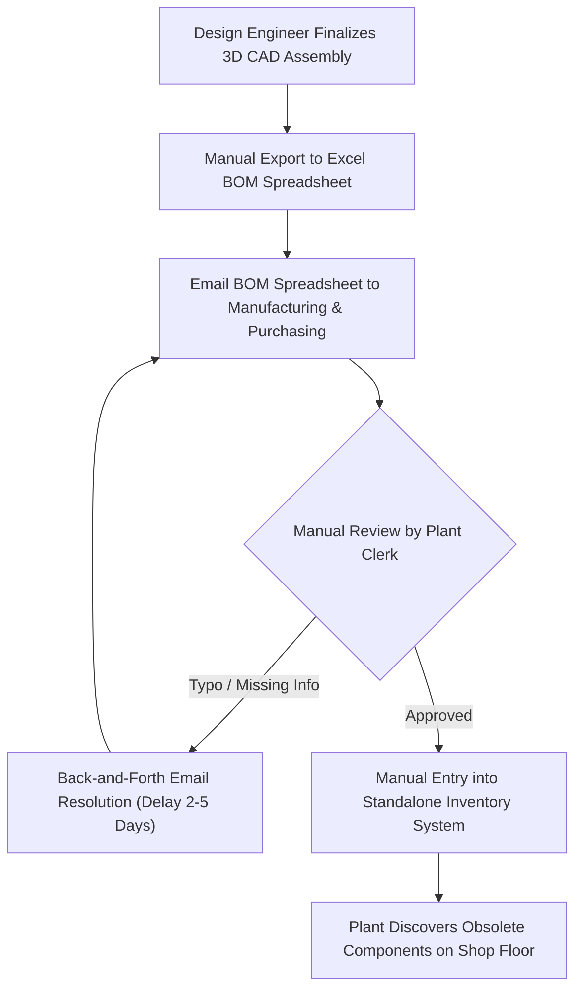
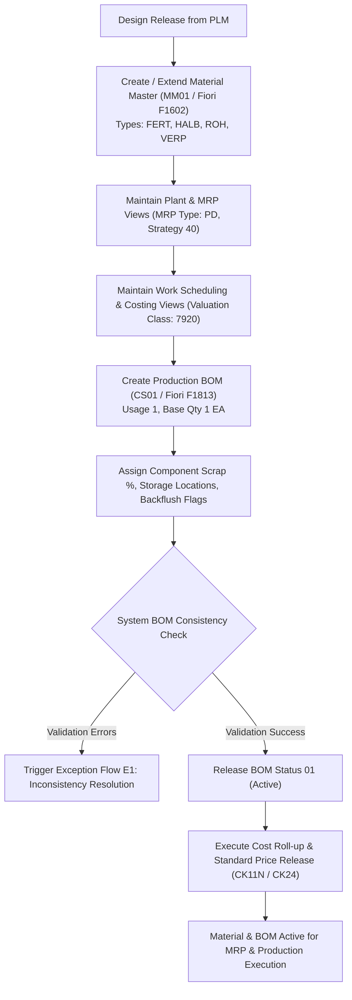
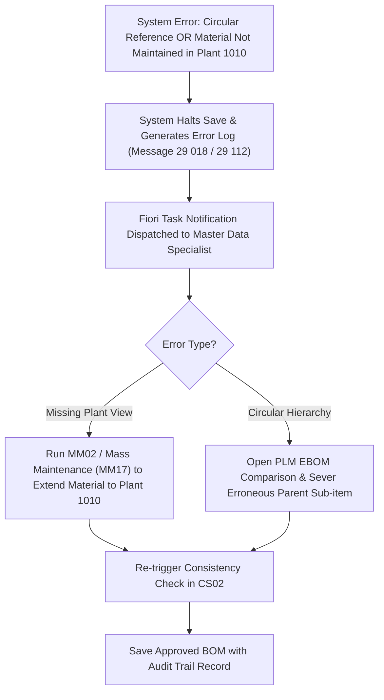

# Scenario Flow SC-01: Product and BOM Definition

**Process Area:** Master Data Management & PLM  
**Reference Release:** SAP S/4HANA 2023 / Cloud Private Edition  
**Business Context:** Automotive Discrete Assembly (Bi-LED Headlamp Assembly `HL-200X`)  
**Linked PRD Deliverable:** Must-Have P0 Scenario Flow 1  

---

## 1. Scenario Overview & Objectives

In discrete automotive lighting assembly, precision in product definition and the Bill of Materials (BOM) is critical. The assembly involves high-precision optical components, electronic drive circuitry, structural housings, and volatile consumable adhesives. This scenario defines the transition from uncoordinated, spreadsheet-managed parts lists to a centrally governed SAP S/4HANA Product Master and Production BOM structure.

### Key Objectives
- Establish harmonized material numbering and classification for Finished Products (`FERT`), Semi-Finished Assemblies (`HALB`), Raw Materials (`ROH`), and Packaging (`VERP`).
- Maintain multi-level Production Bills of Material (Usage `1`) with explicit component scrap percentages, issue storage locations, and backflushing indicators.
- Eliminate manufacturing halts caused by missing material plant views or obsolete component revisions.

---

## 2. Business Actors & Roles

| Actor / Role | Description / Responsibilities | SAP Authorization Role |
| :--- | :--- | :--- |
| **Product Design Lead** | Defines physical specifications, CAD revisions, and engineering parts lists. | `SAP_BR_DESIGN_ENGINEER` |
| **Master Data Specialist** | Creates and validates S/4HANA material master views (Basic, MRP, Work Scheduling, Costing). | `SAP_BR_BOM_ENGINEER` |
| **Production Planner** | Configures MRP parameters, lot sizes, and production scheduling profiles. | `SAP_BR_PRODN_PLNR` |
| **Plant Controller** | Verifies standard cost calculation, cost roll-up, and valuation classes. | `SAP_BR_COST_ACCOUNTANT` |

---

## 3. As-Is Process Flow (Legacy / Pre-SAP)

### Process Narrative
Engineering maintains CAD assemblies in local silos. When a new product is released, a mechanical engineer manually copies part numbers into a multi-tab Excel spreadsheet. This spreadsheet is emailed to purchasing and manufacturing teams. Plant planners re-enter part numbers into a legacy ERP or standalone inventory system.

### Pain Points
1. **Version Divergence:** Revisions made by engineering are not updated simultaneously in plant spreadsheets, causing procurement of obsolete parts.
2. **Missing Scrap Factors:** Consumables like 2K polyurethane adhesive (`HL-ADH-501`) and fasteners suffer routine line-loss that is untracked, resulting in mid-shift stockouts.
3. **Redundant Data Entry:** Manual keying creates typo-prone part numbers, mismatched units of measure, and failed cost calculations.

---

## 4. To-Be Process Flow (SAP S/4HANA)

### Process Narrative
Engineering releases the validated design from PLM. Master Data specialists generate the SAP Product Master via Fiori App **Manage Product Master Data** (`MM01`/`MM02`), populating all required organizational views across Plant `1010`. The Production BOM is created in S/4HANA via Fiori App **Maintain Bill of Material** (`CS01`/`CS02`) with Usage `1` (Production). Standard component scrap percentages, issue storage locations, and backflush parameters are validated systematically.

---

## 5. Process Inputs & Outputs

### Inputs
- Engineering CAD Release Data (Product dimensions, materials, net weight).
- Procurement classifications (Make vs. Buy: Procurement Type `E` for In-house, `F` for External).
- Consumable consumption standards (e.g. 45 grams PUR adhesive per headlamp).

### Outputs
- S/4HANA Material Master records (`MARA`, `MARC`, `MARD`, `MBEW`).
- Active Production BOM Header and Item Records (`MAST`, `STKO`, `STPO`).
- Released Standard Cost Estimate (`KEKO`, `CK24`).

---

## 6. Step-by-Step SAP S/4HANA Execution Details

| Step | Action Description | S/4HANA Fiori App / GUI Code | Key Table | Validation Criteria |
| :--- | :--- | :--- | :--- | :--- |
| **1.1** | Create Finished Product `HL-200X` | `Manage Product Master Data` / `MM01` | `MARA`, `MAKT` | Material Type = `FERT`, Base UoM = `EA`, Gross/Net weight maintained. |
| **1.2** | Extend to Plant `1010` & MRP Views | `Change Material` / `MM02` | `MARC` | MRP Type = `PD`, MRP Controller = `P01`, Lot Size = `EX`, Strategy = `40`. |
| **1.3** | Maintain Work Scheduling View | `Change Material` / `MM02` | `MARC` | Production Scheduling Profile = `PP0001`, Production Supervisor assigned. |
| **1.4** | Create Multi-Level BOM | `Maintain Bill of Material` / `CS01` | `MAST`, `STKO` | Material `HL-200X`, Plant `1010`, Usage `1`, Base Qty = 1 EA. |
| **1.5** | Add Components & Operational Data | `Maintain Bill of Material` / `CS02` | `STPO` | Item Cat `L` (Stock), assign `HL-HOU-101`, `HL-LENS-201`, `HL-PCB-301`, etc. |
| **1.6** | Configure Line Scrap & Backflushing | `Maintain Bill of Material` / `CS02` | `STPO` | Adhesive `HL-ADH-501` scrap = 3.0%, Backflush flag = `1` (Always backflush). |

---

## 7. Exception Flow: Circular Dependency & Missing Plant Extension

### Trigger Condition
During BOM creation in `CS01`, an engineer inadvertently includes a parent assembly as a sub-component of `HL-PCB-301`, or attempts to add a raw material (`HL-ADH-501`) that has not yet been extended to Plant `1010`.

### Remediation Rules
1. **Pre-flight Check:** Automated ABAP/Fiori validation checks that all items in `STPO` have active entries in table `MARC` for Plant `1010` before committing changes.
2. **Cycle Prevention:** SAP S/4HANA recursive BOM checks automatically abort any save that creates an infinite loop in the product hierarchy.
