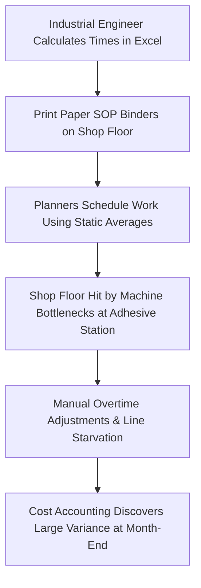
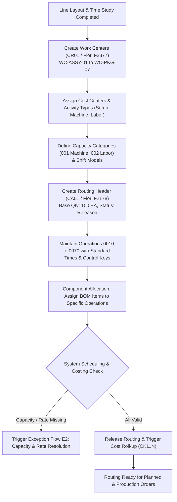
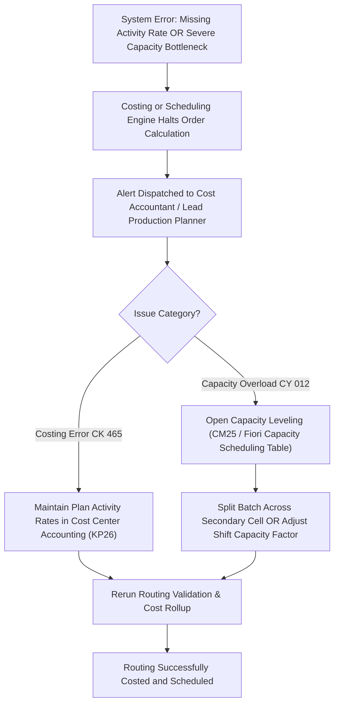

# Scenario Flow SC-02: Routings and Work Centers

**Process Area:** Production Planning (PP) Master Data  
**Reference Release:** SAP S/4HANA 2023 / Cloud Private Edition  
**Business Context:** Discrete Assembly Routing & Shop Floor Work Centers  
**Linked PRD Deliverable:** Must-Have P0 Scenario Flow 2  

---

## 1. Scenario Overview & Objectives

In discrete assembly operations, accurate routings and work centers are the backbone of production scheduling, shop-floor capacity planning, and product costing. This scenario standardizes the production line for the automotive LED headlamp assembly (`HL-200X`) across 7 distinct operations: mechanical sub-assembly, optical alignment, robotic adhesive dispensing, thermal curing, photometric inspection, leak testing, and packaging.

### Key Objectives
- Define work centers with accurate capacity formulas, operating hours (2 shifts = 16 hours/day), and linked cost centers.
- Maintain standard assembly routings with precise standard values for Setup, Machine, and Labor times.
- Assign control keys (`PP01` for standard operations, `QM01` for quality milestone operations) and link BOM components to corresponding operations (Component Allocation).

---

## 2. Business Actors & Roles

| Actor / Role | Description / Responsibilities | SAP Authorization Role |
| :--- | :--- | :--- |
| **Industrial / Process Engineer** | Conducts time-and-motion studies, determines cycle times, and defines routing sequences. | `SAP_BR_ROUTING_SPECIALIST` |
| **Plant Maintenance Supervisor** | Maintains machine technical availability and nominal work center capacity limits. | `SAP_BR_MAINTENANCE_PLANNER` |
| **Production Controller** | Reviews capacity utilization and validates standard value calculations. | `SAP_BR_PRODN_PLNR` |
| **Cost Accountant** | Assigns cost centers and activity types (Setup, Machine, Labor) for product costing. | `SAP_BR_COST_ACCOUNTANT` |

---

## 3. As-Is Process Flow (Legacy / Pre-SAP)

### Process Narrative
Standard operating procedures (SOPs) and operation cycle times are maintained in paper binders located at work stations. Line supervisors balance work manually based on historical intuition. Setup and machine run times are recorded on paper clipboards and rarely updated. Costing uses a single, plant-wide labor overhead percentage rather than machine-specific cost rates.

### Pain Points
1. **Inaccurate Capacity Scheduling:** Planners schedule orders assuming unlimited machine throughput, leading to severe bottlenecks at the robotic adhesive station (`WC-GLUE-03`).
2. **Cost Distortions:** Expensive automated robotic cells share the same overhead rate as manual packaging benches, leading to distorted product margins.
3. **No Component Allocation:** Operators receive a bulk kit for the entire headlamp, causing cluttered workbenches and misplacement of delicate optical lenses.

---

## 4. To-Be Process Flow (SAP S/4HANA)

### Process Narrative
Industrial engineers create dedicated Work Centers in S/4HANA using Fiori App **Manage Work Centers** (`CR01`/`CR02`). Work centers are linked to production cost centers (`CC-PROD-101`, `CC-QUAL-201`), standard value keys (`SAP1`), and capacity formulas. The routing is created via Fiori App **Manage Routings** (`CA01`/`CA02`). BOM components are allocated to specific operations (e.g. PUR adhesive assigned strictly to Op `0030`, Projector lens to Op `0020`), enabling precise line-side material staging.

---

## 5. Work Center Configuration Matrix

| Work Center | Name | Cost Center | Standard Value Key | Control Key | Base Unit | Setup (Min) | Mach (Min) | Lab (Min) |
| :--- | :--- | :--- | :--- | :--- | :--- | :--- | :--- | :--- |
| `WC-ASSY-01` | Housing & Harness Sub-Assembly | `CC-PROD-101` | `SAP1` | `PP01` | 100 EA | 15.0 | 0.0 | 120.0 |
| `WC-OPT-02` | Optical Alignment & Driver Mount | `CC-PROD-101` | `SAP1` | `PP01` | 100 EA | 20.0 | 30.0 | 150.0 |
| `WC-GLUE-03` | Robotic PUR Adhesive Dispensing | `CC-PROD-102` | `SAP1` | `PP01` | 100 EA | 25.0 | 45.0 | 15.0 |
| `WC-CURE-04` | Ultrasonic Mating & Cure Tunnel | `CC-PROD-102` | `SAP1` | `PP01` | 100 EA | 10.0 | 90.0 | 30.0 |
| `WC-TST-05` | In-Process Photometric Darkroom | `CC-QUAL-201` | `SAP1` | `QM01` | 100 EA | 15.0 | 60.0 | 60.0 |
| `WC-LEAK-06` | Helium Leak & Pressure Chamber | `CC-QUAL-201` | `SAP1` | `QM01` | 100 EA | 10.0 | 40.0 | 20.0 |
| `WC-PKG-07` | Protective Film & Barcode Pack | `CC-PROD-103` | `SAP1` | `PP01` | 100 EA | 10.0 | 0.0 | 50.0 |

---

## 6. Step-by-Step SAP S/4HANA Execution Details

| Step | Action Description | S/4HANA Fiori App / GUI Code | Key Table | Validation Criteria |
| :--- | :--- | :--- | :--- | :--- |
| **2.1** | Create Work Center Header & Category | `Manage Work Centers` / `CR01` | `CRHD` | Category `0001` (Machine/Line), Plant `1010`. |
| **2.2** | Assign Standard Value Key | `Change Work Center` / `CR02` | `CRHD` | Key `SAP1` (Setup, Machine, Labor parameters). |
| **2.3** | Configure Capacity & Shift Schedules | `Change Work Center` / `CR02` | `KAKO`, `KAZT` | Shift length = 8 hrs, 2 shifts/day, Operating time = 14.4 hrs (90% utilization). |
| **2.4** | Assign Costing & Activity Types | `Change Work Center` / `CR02` | `CRCO` | Cost Center `CC-PROD-102`, Activity Types `SET`, `MAC`, `LAB`. |
| **2.5** | Create Assembly Routing | `Manage Routings` / `CA01` | `MAPL`, `PLKO` | Group `50001201`, Usage `1`, Status `4` (Released). |
| **2.6** | Maintain Operations & Allocation | `Manage Routings` / `CA02` | `PLPO`, `PLAS` | Operations 0010-0070 maintained; BOM components allocated to matching operations. |

---

## 7. Exception Flow: Missing Activity Rate or Capacity Bottleneck

### Trigger Condition
During product cost estimation (`CK11N`) or production order creation (`CO01`), the system triggers error `CK 465` (No activity price found for Cost Center `CC-PROD-102` / Activity Type `MAC`) or warning `CY 012` (Capacity overload > 120% at Work Center `WC-GLUE-03`).

### Remediation Rules
1. **Financial Period Lockout:** Costing runs will reject routings where `KP26` activity rates are missing for the fiscal year.
2. **Dynamic Work Center Alternate:** If robotic cell `WC-GLUE-03` is overloaded, the routing includes an alternate sequence utilizing manual backup dispensing cell `WC-GLUE-ALT` with updated standard labor times.
