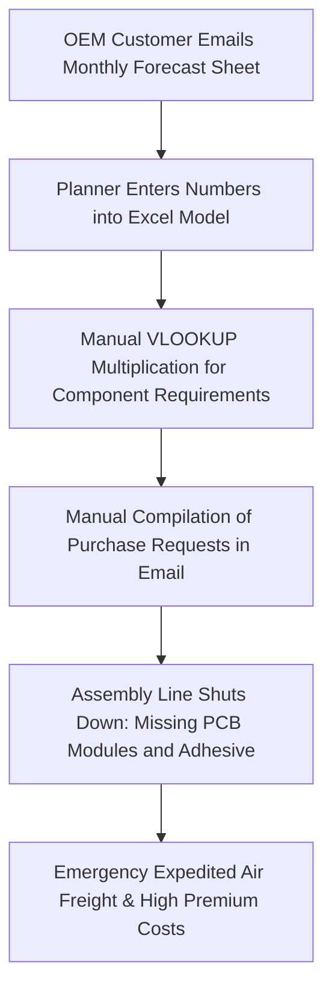
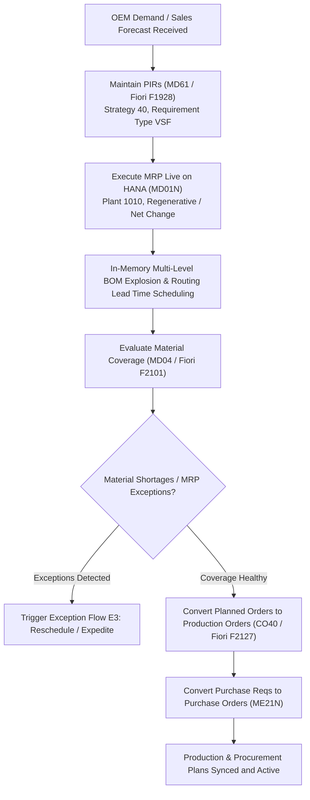
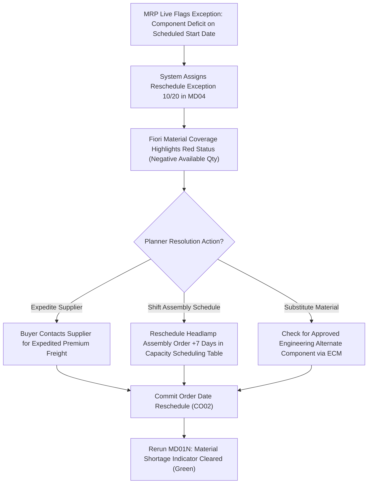

# Scenario Flow SC-03: Demand to Production Plan

**Process Area:** Production Planning & MRP Live  
**Reference Release:** SAP S/4HANA 2023 / Cloud Private Edition  
**Business Context:** Finished Assembly Forecasting, MRP Live Run, and Planned Order Creation  
**Linked PRD Deliverable:** Must-Have P0 Scenario Flow 3 (Core part of BSD)  

---

## 1. Scenario Overview & Objectives

In automotive component manufacturing, Original Equipment Manufacturer (OEM) customer demand fluctuates based on vehicle build rates and weekly broadcast schedules. This scenario models the translation of customer demand forecasts into an actionable, schedule-balanced production plan for the Bi-LED Headlamp Assembly (`HL-200X`) using S/4HANA MRP Live.

### Key Objectives
- Capture monthly and weekly customer forecasts as Planned Independent Requirements (PIRs) under Planning Strategy `40` (Planning with Final Assembly).
- Execute in-memory MRP Live (`MD01N`) across multi-level BOMs to calculate net requirements, explode dependent component demand, and generate planned orders.
- Evaluate the Stock/Requirements list (`MD04` / Fiori `Monitor Material Coverage`) and convert planned orders into released production orders.

---

## 2. Business Actors & Roles

| Actor / Role | Description / Responsibilities | SAP Authorization Role |
| :--- | :--- | :--- |
| **Demand / Supply Planner** | Inputs sales forecasts, analyzes customer schedules, and maintains PIRs. | `SAP_BR_DEMAND_PLANNER` |
| **MRP Controller** | Executes MRP Live, reviews MRP exception messages, and balances component shortages. | `SAP_BR_MATERIAL_PLANNER` |
| **Production Scheduler** | Converts planned orders into production orders and releases them to the shop floor. | `SAP_BR_PRODN_PLNR` |
| **Procurement Buyer** | Manages purchase requisitions generated by MRP for raw materials (`ROH`). | `SAP_BR_BUYER` |

---

## 3. As-Is Process Flow (Legacy / Pre-SAP)

### Process Narrative
Sales forecasts arrive via email spreadsheets. Planners copy monthly totals into an internal forecasting spreadsheet. Every Monday, a planner uses Excel VLOOKUP formulas to multiply finished unit quantities by a BOM list to estimate component demand. Lead times are calculated manually based on memory.

### Pain Points
1. **Spreadsheet Calculation Lag:** Calculating 8 levels of components for multiple models takes 2 full days, resulting in delayed purchase requisitions.
2. **Hidden Stockouts:** Excel does not consider open purchase orders, safety stock thresholds, or WIP inventory accurately. Stockouts are discovered mid-week on the assembly line.
3. **No Closed-Loop Rescheduling:** When OEM delivery dates change, planners cannot dynamically push out dependent component delivery schedules.

---

## 4. To-Be Process Flow (SAP S/4HANA)

### Process Narrative
Demand planners enter monthly/weekly forecast quantities using Fiori App **Maintain Planned Independent Requirements** (`MD61`). Planning Strategy `40` allows incoming sales orders to consume PIRs dynamically. The MRP Controller triggers **Schedule MRP Runs / MRP Live** (`MD01N`), which computes net requirements directly on SAP HANA in seconds. Planned orders are created for in-house assemblies (`HL-200X`, `HL-HOU-101`), and purchase requisitions are created for raw materials (`HL-ADH-501`, `HL-HAR-401`). Planners inspect coverage using Fiori App **Monitor Material Coverage** (`MD04`) and convert planned orders to production orders.

---

## 5. Master Data Planning Configuration

| Parameter | Configuration Value | S/4HANA Impact |
| :--- | :--- | :--- |
| **MRP Type** | `PD` (Standard MRP) | Triggers requirement calculation based on bill of material explosion. |
| **MRP Controller** | `P01` (Automotive Lighting Line 1) | Segregates material portfolio for targeted workbench monitoring. |
| **Lot Size Procedure** | `EX` (Exact Lot-for-Lot) | Minimizes inventory holding costs by sizing orders to demand periods. |
| **Procurement Type** | `E` (In-house) for FERT/HALB, `F` (External) for ROH | Distinguishes planned orders from purchase requisitions. |
| **Planning Strategy** | `40` (Planning with Final Assembly) | PIRs are consumed by incoming sales orders; prevents double-planning. |
| **Safety Stock** | Dynamic Safety Stock (Coverage: 3 days) | Buffers against supplier lead-time fluctuations without overstocking. |

---

## 6. Step-by-Step SAP S/4HANA Execution Details

| Step | Action Description | S/4HANA Fiori App / GUI Code | Key Table | Validation Criteria |
| :--- | :--- | :--- | :--- | :--- |
| **3.1** | Create Planned Independent Requirements | `Maintain PIRs` / `MD61` | `PBIM`, `PBED` | Active version `00`, Strategy `40`, monthly buckets maintained. |
| **3.2** | Run MRP Live In-Memory Engine | `Schedule MRP Runs` / `MD01N` | `MDKP`, `MDTB` | Execution completed in HANA database layer without fallback to classic MRP. |
| **3.3** | Monitor Planned Orders & Reschedules | `Monitor Material Coverage` / `MD04` | `PLAF`, `EBAN` | Planned orders generated for `HL-200X`; purchase requisitions generated for `ROH`. |
| **3.4** | Capacity Check During Lead-Time Scheduling | `Evaluate Capacity` / `CM01` | `KBKO`, `KBED` | Work Center loading checked across operations 0010 to 0070. |
| **3.5** | Convert Planned Order to Production Order | `Convert Planned Order` / `CO40` | `AFKO`, `AFPO` | Order type `PP01`, order number assigned, BOM and routing copied. |

---

## 7. Exception Flow: Critical Component Lead Time Shortage

### Trigger Condition
During the MRP Live run, the system determines that the Bi-LED driver module (`HL-PCB-301`) has a supplier delivery lead time of 14 days, but the planned start date of production order for `HL-200X` is in 5 days, resulting in an unfulfillable stock deficit (MRP Exception Message `10` - Bring process forward, or Message `20` - Cancel process).

### Remediation Rules
1. **Automated Reschedule Alerts:** S/4HANA automatically generates reschedule proposals in the MRP controller’s Fiori dashboard if PO delivery date deviates from required dependent demand date by > 24 hours.
2. **Order Release Gatekeeper:** S/4HANA production scheduling profile `PP0001` prevents hard order release if critical missing parts exist in ATP check (`CO02` component availability check).
