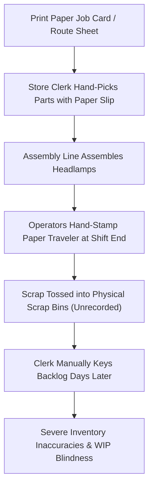
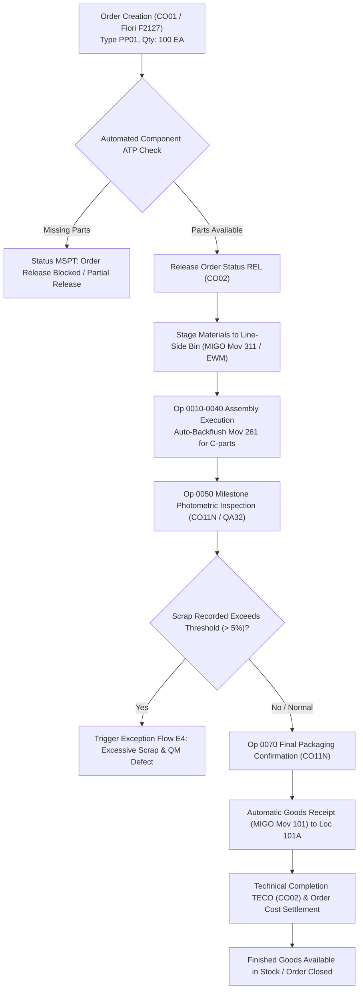
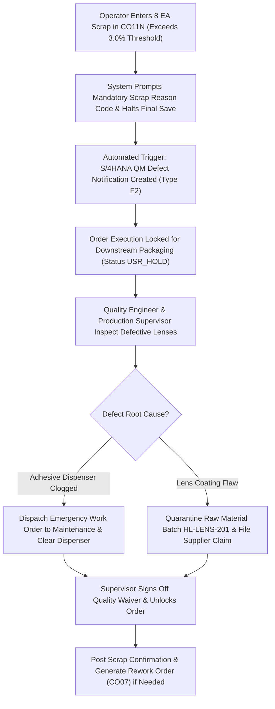

# Scenario Flow SC-04: Production Order Execution and Confirmation

**Process Area:** Production Planning (PP) / Shop Floor Execution  
**Reference Release:** SAP S/4HANA 2023 / Cloud Private Edition  
**Business Context:** Discrete Assembly Order Lifecycle, Milestone Confirmations, Scrap, and Goods Movements  
**Linked PRD Deliverable:** Must-Have P0 Scenario Flow 4 (Primary basis for FRD, User Stories, and Test Plan)  

---

## 1. Scenario Overview & Objectives

Production order execution is the core operational phase where master data, planning schedules, shop floor resources, and inventory movements converge. This scenario maps the complete lifecycle of a discrete Production Order (`PP01`) for 100 units of the Bi-LED Headlamp Assembly (`HL-200X`) in Plant `1010`.

### Key Objectives
- Execute systematic order creation, dynamic component availability check (ATP), and order release (`CRTD` -> `REL`).
- Stage materials to line-side storage locations and execute Goods Issue (Movement Type `261`) via automated backflushing and manual posting.
- Record operation confirmations (milestone and time ticket) via Fiori App **Confirm Production Operation** (`CO11N`), capturing actual yield, scrap, and labor/machine hours.
- Perform Goods Receipt (Movement Type `101`) into finished goods storage location `101A` and achieve Technical Completion (`TECO`).

---

## 2. Business Actors & Roles

| Actor / Role | Description / Responsibilities | SAP Authorization Role |
| :--- | :--- | :--- |
| **Production Supervisor** | Converts planned orders, performs ATP checks, releases orders, and reviews execution progress. | `SAP_BR_PRODN_SUPERVISOR` |
| **Line Assembly Operator** | Performs physical assembly, confirms operation quantities, records scrap, and scans barcodes. | `SAP_BR_PRODN_OPERATOR` |
| **Warehouse Material Handler** | Picks and stages components to line-side storage bins (`101B`, `101C`) via goods movement. | `SAP_BR_WAREHOUSE_CLERK` |
| **Plant Quality Inspector** | Validates milestone test operations (Op 0050 Photometrics, Op 0060 Leak Test). | `SAP_BR_QUALITY_INSPECTOR` |

---

## 3. As-Is Process Flow (Legacy / Pre-SAP)

### Process Narrative
Shop orders are printed as multi-page paper traveler packets ("job cards"). Store clerks pull parts from central stores and write handwritten quantities on paper tally sheets. Operators stamp paper cards upon completing operations. Actual labor and machine run times are unrecorded. Scrap is tossed into plastic bins and counted by line supervisors at the end of the week.

### Pain Points
1. **Blind Execution:** Plant management has zero visibility into work-in-process (WIP). An order is assumed "in progress" until physical finished units reach the shipping dock.
2. **Ghost Inventory:** Consumed parts remain in the system inventory for days until clerks manually enter paper store requisitions, causing erroneous stock availability signals.
3. **Delayed Scrap Accountability:** Unreported scrap accumulates until month-end, hiding high-cost defects such as damaged projector lenses or punctured gaskets.

---

## 4. To-Be Process Flow (SAP S/4HANA)

### Process Narrative
The Production Supervisor creates the order in S/4HANA via Fiori App **Manage Production Orders** (`CO01`/`CO02`). An automated Available-to-Promise (ATP) check verifies component stock. Upon release (`REL`), shop floor traveler cards with 2D DataMatrix barcodes are printed. Components configured with backflush (e.g. screws, PUR adhesive, gaskets) are issued automatically (Movement `261`) upon operation confirmation; high-value items (LED drivers `HL-PCB-301`) are issued with serial tracking. Operators record confirmations via Fiori App **Confirm Production Operation** (`CO11N`). Upon final milestone confirmation (Op 0070), an automatic Goods Receipt (Movement `101`) is posted to finished inventory.

---

## 5. Order Status Progression Lifecycle

| Status Code | Status Name | Description & System Action |
| :--- | :--- | :--- |
| `CRTD` | Created | Production order generated, BOM and routing copied, reservation numbers created. Goods movements not allowed. |
| `PREL` | Partially Released | Selected early operations released; downstream operations held. |
| `REL` | Released | Order active for shop floor execution. Shop floor papers can be printed. Goods issue and confirmations allowed. |
| `PCNF` | Partially Confirmed | One or more operations confirmed with partial yield; order remains open. |
| `CNF` | Confirmed | All mandatory operations confirmed with final yield. |
| `PDLV` | Partially Delivered | Partial goods receipt posted into finished inventory (Movement `101`). |
| `DLV` | Delivered | Full ordered quantity received into finished goods stock. |
| `TECO` | Technically Completed | Production execution closed. No further goods issues or confirmations allowed. Ready for financial variance settlement. |
| `CLSD` | Closed | Financially settled; balance = 0. Order archived. |

---

## 6. Step-by-Step SAP S/4HANA Execution Details

| Step | Action Description | S/4HANA Fiori App / GUI Code | Key Table | Validation Criteria |
| :--- | :--- | :--- | :--- | :--- |
| **4.1** | Create Production Order for `HL-200X` | `Manage Production Orders` / `CO01` | `AFKO`, `AFPO` | Order Type `PP01`, Plant `1010`, Quantity = 100 EA, Scheduling = Current Date. |
| **4.2** | Perform Dynamic Availability Check | `Change Production Order` / `CO02` | `RESB` | Check control `PP01`; verifies unrestricted stock in storage locations `101B`/`101C`. |
| **4.3** | Release Production Order | `Change Production Order` / `CO02` | `JEST`, `JCDS` | Status transitions from `CRTD` to `REL`; reservation items activated for picking. |
| **4.4** | Issue Non-Backflushed Components | `Post Goods Movement` / `MIGO` | `MSEG`, `MKPF` | Movement Type `261`, Reference Production Order, Material `HL-PCB-301`. |
| **4.5** | Milestone Confirmation Op 0050 | `Confirm Production Operation` / `CO11N` | `AFRU` | Yield = 98 EA, Scrap = 2 EA, Setup/Machine/Labor actual hours entered. Backflushes components for Op 0010-0040. |
| **4.6** | Final Confirmation & Auto Goods Receipt | `Confirm Production Operation` / `CO11N` | `AFRU`, `MSEG` | Op 0070 confirmed. Automated Movement `101` posts 98 EA into storage location `101A`. Order status `DLV`. |
| **4.7** | Technical Completion | `Change Production Order` / `CO02` | `AFKO` | Status set to `TECO`; open reservations cancelled. |

---

## 7. Exception Flow: Excessive Operation Scrap & Defect Lockout

### Trigger Condition
During confirmation of Operation `0040` (Ultrasonic Curing & Lens Mating) or Operation `0050` (Photometric Test) via `CO11N`, an operator enters a scrap quantity of 8 units against a batch of 100 (8.0% scrap, exceeding the configured quality tolerance threshold of 3.0%).

### Remediation Rules
1. **Mandatory Reason Codes:** Any scrap entry in `CO11N` requires a 4-character Reason Code (e.g., `0101` Adhesive Seal Void, `0102` Optical Cutoff Failure). Blank scrap entries are rejected by system validation.
2. **Supervisor Override:** When scrap exceeds the 3% line threshold, saving the confirmation requires authorization object `C_AFKO_AWA` (Plant Production Supervisor sign-off).
