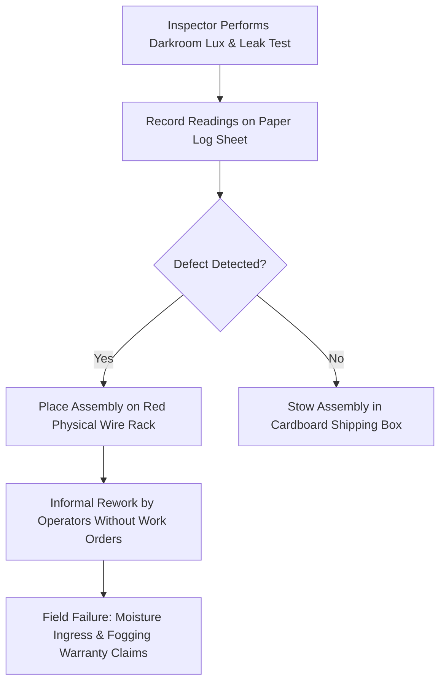
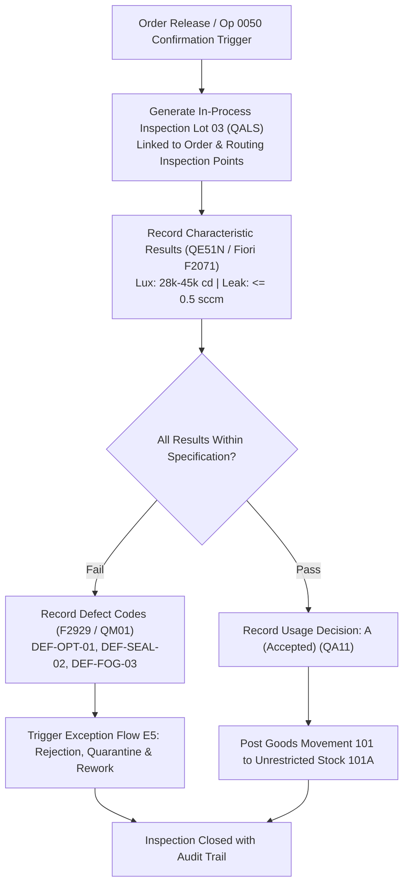
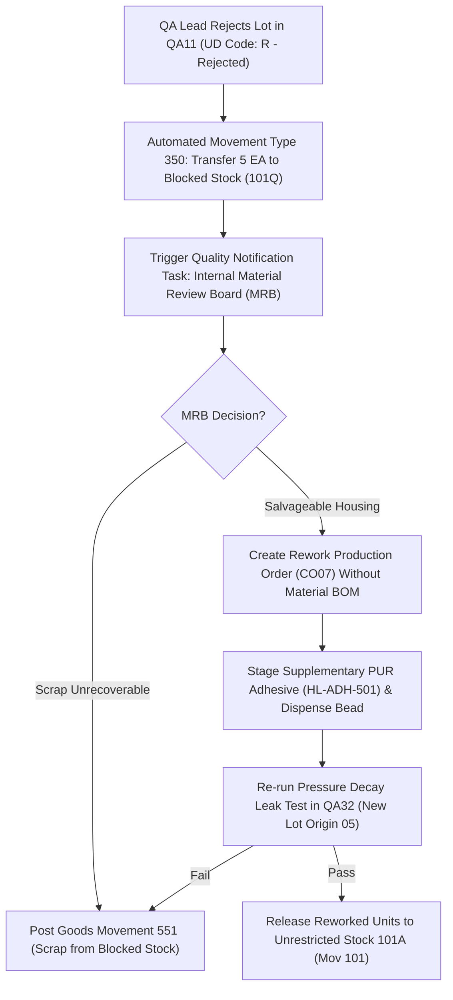

# Scenario Flow SC-05: Quality Inspection and Defect Handling

**Process Area:** Quality Management (QM) & Defect Tracking  
**Reference Release:** SAP S/4HANA 2023 / Cloud Private Edition  
**Business Context:** In-Process (Origin 03) & Goods Receipt (Origin 04) Inspection, Defect Recording, and Rework  
**Linked PRD Deliverable:** Must-Have P0 Scenario Flow 5 (Tied to FRD and Test Cases)  

---

## 1. Scenario Overview & Objectives

In automotive lighting manufacturing, failure to comply with photometric luminous intensity or hermetic sealing specifications causes regulatory non-compliance (ECE/DOT standards) and vehicle warranty recalls. This scenario models systematic quality inspection within SAP S/4HANA QM for the Bi-LED Headlamp Assembly (`HL-200X`).

### Key Objectives
- Generate automated In-Process Inspection Lots (Inspection Type `03`) linked to routing milestone operations `0050` (Photometrics) and `0060` (Leak Test).
- Record quantitative and qualitative inspection characteristics using Fiori App **Record Inspection Results** (`QE51N`/`QA32`).
- Capture standard defect catalog codes (`DEF-OPT-01` Lux Failure, `DEF-SEAL-02` Adhesive Void, `DEF-FOG-03` Lens Fogging) via Fiori App **Record Defects** (`F2929`).
- Execute Usage Decisions (`QA11`) with automated inventory posting (Unrestricted `101A`, Blocked `101Q`, or Rework Order `CO07`).

---

## 2. Business Actors & Roles

| Actor / Role | Description / Responsibilities | SAP Authorization Role |
| :--- | :--- | :--- |
| **Shop Floor Quality Inspector** | Executes physical tests in the darkroom/pressure chamber and records readings in S/4HANA. | `SAP_BR_QUALITY_INSPECTOR` |
| **Quality Assurance Lead** | Evaluates defect notifications, leads root cause analysis (8D), and makes Usage Decisions. | `SAP_BR_QUALITY_ENGINEER` |
| **Production Supervisor** | Receives defect notifications, manages quarantined WIP, and coordinates rework orders. | `SAP_BR_PRODN_SUPERVISOR` |
| **Plant Quality Manager** | Analyzes defect Pareto trends and signs off on supplier chargebacks or line stoppages. | `SAP_BR_QUALITY_MANAGER` |

---

## 3. As-Is Process Flow (Legacy / Pre-SAP)

### Process Narrative
Inspectors record photometric lux measurements and pressure drop values on handwritten paper logs clipped to the darkroom wall. Defective headlamps (e.g. failing cutoff line or exhibiting adhesive voids) are placed on an unmonitored red wire rack. No formal correlation exists between the scrap on the rack and the original shop traveler. At month-end, a technician keys tally marks into Excel to create a defect bar chart.

### Pain Points
1. **Uncontrolled Rework:** Operators frequently grab rejected lamps from the red rack and re-glue them without engineering oversight, masking critical adhesive degradation.
2. **Untraceable Root Cause:** Because defect data is not linked to serial or order numbers, recurring supplier issues (such as contaminated polycarbonate resin) cannot be traced back to specific resin batches.
3. **Delayed Customer Consequence:** Leak defects slip through unrecorded, leading to catastrophic moisture condensation warranty claims in the field.

---

## 4. To-Be Process Flow (SAP S/4HANA)

### Process Narrative
Upon releasing the production order, S/4HANA QM automatically creates an In-Process Inspection Lot (Origin `03`). At Operation `0050`, the inspector opens Fiori App **Record Inspection Results** (`QE51N`), entering quantitative photometric lux (tolerance: 28,000 - 45,000 cd) and qualitative cutoff pattern. At Operation `0060`, the helium leak rate (tolerance: <= 0.5 sccm) is recorded. If a test fails, the inspector logs defects directly via Fiori App **Record Defects** (`F2929`), triggering a Quality Notification (Type `F2`). The QA Lead performs a Usage Decision via Fiori App **Usage Decision** (`QA11`). Rejections trigger an automated stock posting to Blocked Stock (`350`) or initiate a Rework Production Order (`CO07`).

---

## 5. Inspection Characteristics & Catalog Specifications

| Insp. Char ID | Characteristic Name | Type | Target Value | Lower Limit | Upper Limit | Defect Code Assigned |
| :--- | :--- | :--- | :--- | :--- | :--- | :--- |
| `MIC-OPT-01` | Luminous Intensity (High Beam) | Quantitative | 35,000 cd | 28,000 cd | 50,000 cd | `DEF-OPT-01` (Low Photometrics) |
| `MIC-OPT-02` | Asymmetric Cutoff Line Sharpness | Qualitative | Class 1 Pass | Pass / Fail | - | `DEF-OPT-01` (Blurred Cutoff) |
| `MIC-LEAK-01`| Differential Pressure Decay Rate | Quantitative | 0.20 sccm | 0.0 sccm | 0.50 sccm | `DEF-SEAL-02` (Adhesive Void) |
| `MIC-VIS-01` | Inner Lens Fogging / Moisture | Qualitative | No Condensation | Pass / Fail | - | `DEF-FOG-03` (Lens Fogging) |
| `MIC-ELEC-01`| 12V Harness Terminal Resistance | Quantitative | 15 mOhm | 5 mOhm | 25 mOhm | `DEF-HAR-04` (High Resistance) |

---

## 6. Step-by-Step SAP S/4HANA Execution Details

| Step | Action Description | S/4HANA Fiori App / GUI Code | Key Table | Validation Criteria |
| :--- | :--- | :--- | :--- | :--- |
| **5.1** | Verify In-Process Inspection Lot | `Manage Inspection Lots` / `QA32` | `QALS` | Lot Origin `03`, Status `REL` (Released), Linked to Order `1000845`. |
| **5.2** | Record Inspection Results | `Record Results` / `QE51N` | `QAMV`, `QASR` | Enter actual measured values; system evaluates status (Accepted/Rejected). |
| **5.3** | Record Defect Notification | `Record Defects` / `F2929` (`QM01`) | `QMEL`, `QMFE` | Notification Type `F2`, Defect Code `DEF-SEAL-02`, Defect Quantity = 3 EA. |
| **5.4** | Make Usage Decision (UD) | `Record Usage Decision` / `QA11` | `QAVE` | UD Code `A` (Accept) or `R` (Reject). Valuation recorded. |
| **5.5** | Stock Posting from Inspection Lot | `Record Usage Decision` / `QA11` | `MSEG` | Movement `321` (Quality to Unrestricted) or `350` (Quality to Blocked). |

---

## 7. Exception Flow: Inspection Lot Rejection & Controlled Rework Order

### Trigger Condition
During Usage Decision evaluation in `QA11`, 5 units fail characteristic `MIC-LEAK-01` due to an adhesive void (`DEF-SEAL-02`). The QA Lead rejects the lot quantity (`UD Code: R`) and prevents transfer to finished goods.

### Remediation Rules
1. **Stock Lockout:** Units rejected under `QA11` cannot be issued to sales orders or shipped under any circumstance until cleared by an MRB disposition.
2. **Rework Cost Segregation:** Rework costs are booked against a distinct settlement order (`CO07`), ensuring line scrap variances are not hidden within standard production accounts.
