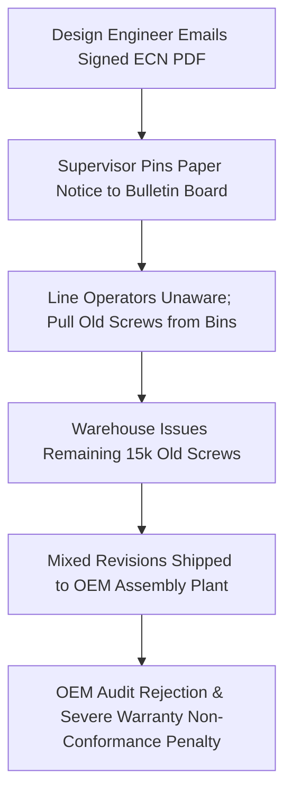
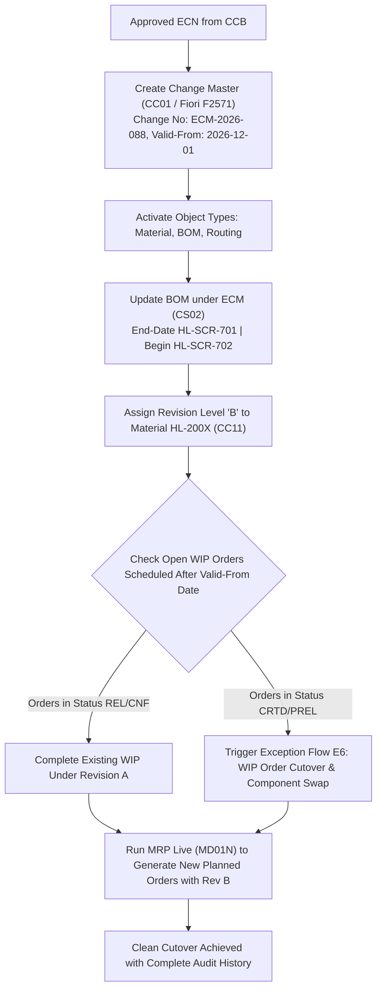
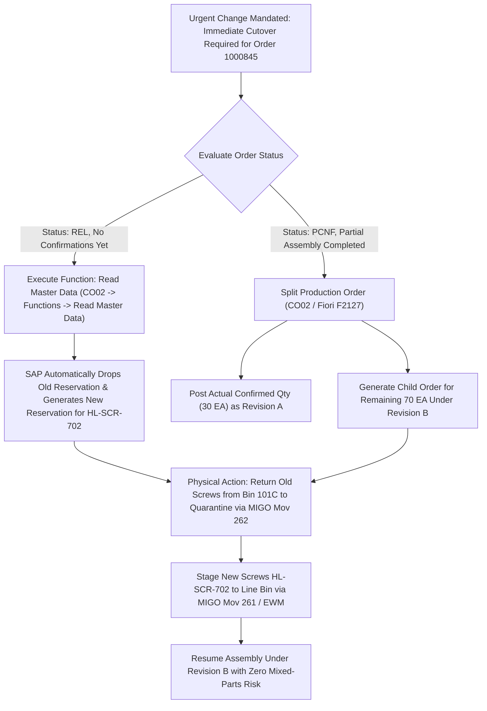

# Scenario Flow SC-06: Engineering Change to Production

**Process Area:** PLM Change Management & Engineering Change Management (ECM)  
**Reference Release:** SAP S/4HANA 2023 / Cloud Private Edition  
**Business Context:** Engineering Change Master (ECM), Revision Levels, and Production Cutover  
**Linked PRD Deliverable:** Must-Have P0 Scenario Flow 6 (Core part of BSD & FRD)  

---

## 1. Scenario Overview & Objectives

In automotive component manufacturing, engineering changes occur frequently due to continuous improvement, supplier material obsolescence, cost reduction, or field quality feedback. This scenario models how an Engineering Change Notice (ECN) initiated in PLM is executed in SAP S/4HANA using Engineering Change Management (ECM) for the Bi-LED Headlamp Assembly (`HL-200X`).

### Example Engineering Change
- **ECN Reference:** `ECN-2026-088` (Thermal & Fastener Enhancement).
- **Change Scope:** Replace zinc fastener `HL-SCR-701` (M4x16) with high-torque anti-vibration fastener `HL-SCR-702` (M4x18), and upgrade thermal interface paste on the LED driver module (`HL-PCB-301`) to mitigate operating temperature hotspots.

### Key Objectives
- Create and govern an SAP S/4HANA Change Master Record (`CC01`/`CC02`) with an explicit Valid-From Date and object management records (BOM, Routing, Material).
- Apply engineering changes to the Production BOM (`CS02`) with historical version preservation (validity date slicing).
- Assign Material Revision Levels (`CC11`) and manage cutover rules for open Planned Orders and Work-in-Process (WIP) Production Orders.

---

## 2. Business Actors & Roles

| Actor / Role | Description / Responsibilities | SAP Authorization Role |
| :--- | :--- | :--- |
| **Engineering Change Coordinator** | Creates Change Master records, defines release dates, and chairs Change Control Board (CCB). | `SAP_BR_ENGG_CHG_COORDINATOR` |
| **BOM / Master Data Engineer** | Modifies S/4HANA BOMs and routings with reference to the approved Change Number. | `SAP_BR_BOM_ENGINEER` |
| **Production Planner** | Analyzes effectivity dates, checks open WIP inventory, and schedules cutover points. | `SAP_BR_PRODN_PLNR` |
| **Shop Floor Supervisor** | Enforces physical part cutover on the assembly line, purging obsolete bins. | `SAP_BR_PRODN_SUPERVISOR` |

---

## 3. As-Is Process Flow (Legacy / Pre-SAP)

### Process Narrative
The product development team issues a signed PDF titled "Engineering Change Notice" and sends it via email distribution to plant heads. The document states: *"Effective immediately, switch to M4x18 screw."* The line supervisor prints the PDF and pins it to the notice board. Because the warehouse still has 15,000 units of the old screw in stock, operators continue using them until bins run dry.

### Pain Points
1. **Uncontrolled Mixed Revisions:** Finished headlamps are shipped containing mixed fastener revisions under the same serial sequence, causing customer assembly line rejection.
2. **Scrap vs. Use-Up Ambiguity:** No systematic flag indicates whether old stock should be scrapped immediately or consumed until exhausted ("run-out" strategy).
3. **No Historical Traceability:** In legacy spreadsheets, old BOM rows are simply overwritten, erasing design audit trails required by IATF 16949 standards.

---

## 4. To-Be Process Flow (SAP S/4HANA)

### Process Narrative
The Change Coordinator creates an Engineering Change Master (`ECM`) in S/4HANA via Fiori App **Manage Change Masters** (`CC01`) with an effective Valid-From Date (e.g., `2026-12-01`). The Master Data Engineer edits the Production BOM in `CS02` referencing the Change Number. SAP ECM automatically sets the Valid-To date of `HL-SCR-701` to `2026-11-30` and introduces `HL-SCR-702` effective `2026-12-01`. Revision Level `B` is assigned to `HL-200X` (`CC11`). MRP Live automatically schedules requirements for the new component from the effectivity date. Open production orders are managed via cutover rules.

---

## 5. Engineering Change Configuration Matrix

| Parameter | Configuration Value | S/4HANA Technical Impact |
| :--- | :--- | :--- |
| **Change Number** | `ECM-2026-088` | Governs transaction history in table `AENR`. |
| **Valid-From Date** | `2026-12-01` | Determines exact split in validity intervals (`STPO-DATUV`). |
| **Object Types** | Material, BOM, Routing | Permits change authorization across all three master data objects. |
| **Revision Level** | `B` (Linked to `HL-200X`) | Visible in sales orders, production orders, and certificates of analysis. |
| **Discontinuation Type** | `1` (Single Discontinuation) | S/4HANA MRP automatically switches from `HL-SCR-701` to `HL-SCR-702` when stock hits zero. |
| **Follow-Up Material** | `HL-SCR-702` | Configured in Material Master MRP 4 view of obsolete component. |

---

## 6. Step-by-Step SAP S/4HANA Execution Details

| Step | Action Description | S/4HANA Fiori App / GUI Code | Key Table | Validation Criteria |
| :--- | :--- | :--- | :--- | :--- |
| **6.1** | Create Change Master Record | `Manage Change Masters` / `CC01` | `AENR`, `AEOI` | Change Number `ECM-2026-088`, Status `1` (Active), Object types enabled. |
| **6.2** | Assign Material Revision Level | `Maintain Revision Level` / `CC11` | `MCOR` | Revision Level `B` assigned to `HL-200X`, linked to Change Number. |
| **6.3** | Modify Production BOM with ECM | `Maintain Bill of Material` / `CS02` | `STKO`, `STPO` | Enter Change Number; set deletion indicator/valid-to for item 0070, insert new item 0071. |
| **6.4** | Configure Discontinuation in MRP 4 | `Change Material` / `MM02` | `MARC` | Set Discontinuation indicator `1`, Eff. Date `2026-12-01`, Follow-up = `HL-SCR-702`. |
| **6.5** | Execute Where-Used List Analysis | `Display Where-Used List` / `CS15` | `STPO` | Identify all assemblies affected by discontinuation of `HL-SCR-701`. |

---

## 7. Exception Flow: In-Flight WIP Production Order Collision

### Trigger Condition
An urgent safety-related engineering change requires immediate cutover (`Valid-From: TODAY`). However, Production Order `1000845` for 100 units is already in status `REL` (Released), and obsolete screws (`HL-SCR-701`) are physically sitting in line-side storage bins `101C`.

### Remediation Rules
1. **Read Master Data Restriction:** S/4HANA allows "Read Master Data" in `CO02` only if no goods issues (Movement `261`) or operation confirmations have been posted.
2. **Order Splitting / Scrap Reconciliation:** If confirmations have started, the order is split; old materials already assembled are audited, and unused old stock is credited back to the warehouse using Movement Type `262` (Reversal of Goods Issue).
