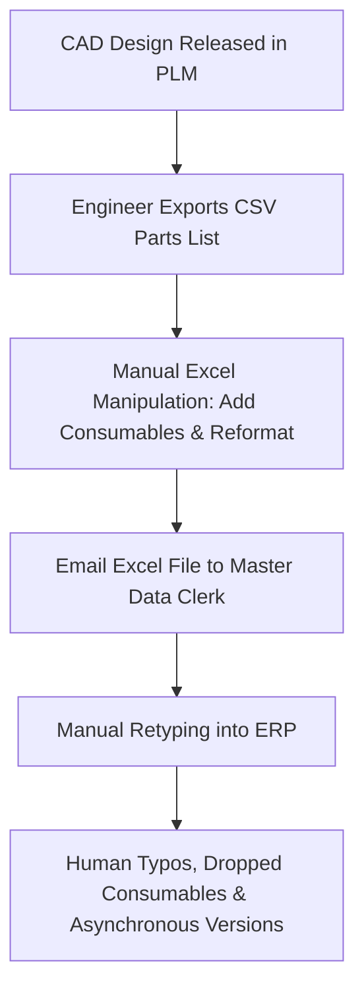
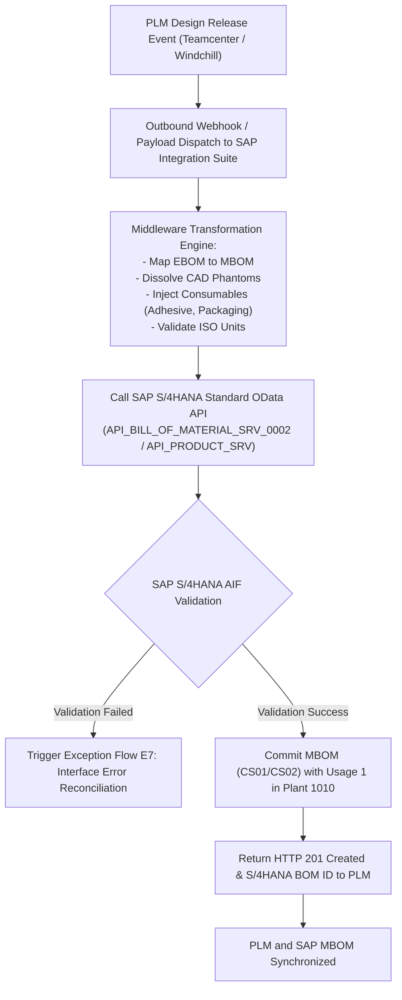
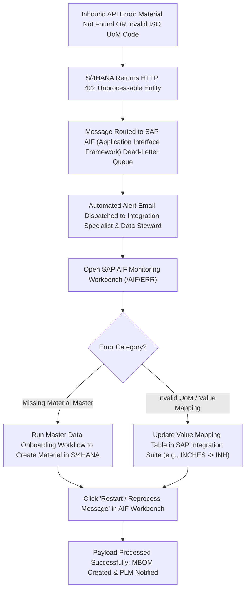

# Scenario Flow SC-07: PLM-to-ERP Data Transfer

**Process Area:** Cross-System Integration & PLM-to-ERP Handoff  
**Reference Release:** SAP S/4HANA 2023 / Cloud Private Edition & SAP Integration Suite  
**Business Context:** EBOM to MBOM Realignment, CAD Part Release, and Engineering Change Transfer  
**Linked PRD Deliverable:** Must-Have P0 Scenario Flow 7 (Basis for Integration Mapping Sheet)  

---

## 1. Scenario Overview & Objectives

In discrete automotive component manufacturing, engineering design originates in Product Lifecycle Management (PLM) systems (such as Siemens Teamcenter, PTC Windchill, or Dassault 3DEXPERIENCE), while manufacturing execution and procurement are governed in SAP S/4HANA. This scenario models the automated, bidirectional data pipeline synchronizing CAD engineering structures with SAP master data.

### Key Objectives
- Automate the transformation of the Engineering Bill of Materials (EBOM) into a plant-specific Manufacturing Bill of Materials (MBOM).
- Inject non-geometric items (consumable adhesives `HL-ADH-501`, lubricants, protective shipping cartons `HL-PKG-801`) into the MBOM structure.
- Transmit Engineering Change Notices (ECNs) into SAP S/4HANA Change Masters (`AENR`) with audit logs.
- Provide a robust exception management framework via SAP Application Interface Framework (AIF) or SAP Integration Suite message monitoring.

---

## 2. Business Actors & Roles

| Actor / Role | Description / Responsibilities | SAP Authorization Role |
| :--- | :--- | :--- |
| **PLM Design Engineer** | Finalizes 3D CAD models, creates EBOM, and initiates the design release workflow. | External PLM Role |
| **Manufacturing Process Engineer** | Maps EBOM nodes to MBOM operations and assigns plant-specific consumable items. | `SAP_BR_BOM_ENGINEER` |
| **Integration Middleware Specialist** | Monitors SAP Integration Suite pipelines, message queues, and API payloads. | `SAP_BR_INTEGRATION_SPECIALIST`|
| **SAP Master Data Administrator** | Manages interface error queues and approves schema mapping adjustments. | `SAP_BR_ADMINISTRATOR` |

---

## 3. As-Is Process Flow (Legacy / Pre-SAP)

### Process Narrative
When a design reaches "Approved" status in PLM, an engineer exports a comma-separated values (CSV) parts list. The engineer manually opens this CSV in Excel, cuts and pastes columns to match an internal template, manually adds lines for adhesive and packaging cartons, and emails the file to an ERP data-entry clerk. The clerk retypes the data line by line into the plant ERP.

### Pain Points
1. **Geometric vs. Manufacturing Disconnect:** CAD models do not include bulk chemicals, thermal grease, or tape. Manual addition in Excel is frequently omitted, leaving production lines without critical assembly consumables.
2. **CAD Phantoms:** Engineering structures contain structural CAD groupings (e.g., "Left Bracket Virtual Sub-assembly") that do not exist physically on the shop floor, causing phantom inventory confusion.
3. **Data Desynchronization:** If an engineer revises a CAD model, there is no automated trigger informing the ERP clerk, resulting in outdated parts being procured for weeks.



---

## 4. To-Be Process Flow (SAP S/4HANA & SAP Integration Suite)

### Process Narrative
When an assembly reaches the "Released for Production" milestone in PLM, an automated outbound webhook sends a structured JSON payload to **SAP Integration Suite** (Cloud Integration). The middleware executes pre-configured transformation rules: it resolves CAD phantoms, verifies SAP material master availability, injects standard manufacturing consumables from a plant recipe catalog, and converts engineering units of measure to SAP ISO codes. The middleware then calls the standard S/4HANA OData API **Bill of Material API** (`API_BILL_OF_MATERIAL_SRV_0002`). S/4HANA commits the MBOM, and a confirmation message returns the SAP BOM number back to the PLM record.



---

## 5. Architectural Interface Specification

```
+---------------------+         HTTPS / TLS 1.3        +-------------------------------+
|     PLM System      |   ------------------------>   |    SAP Integration Suite      |
| (Teamcenter/Windchill)|                             |    (Cloud Integration / BTP)  |
+---------------------+                               +-------------------------------+
                                                                      |
                                                                      | OData v2/v4 REST / RFC
                                                                      v
                                                      +-------------------------------+
                                                      |      SAP S/4HANA Core         |
                                                      |  (AIF / OData / Tables MAST)  |
                                                      +-------------------------------+
```

### Key Interface Touchpoints
1. **Material Master Inbound:** `API_PRODUCT_SRV_0001` (Create / update basic data, dimensions, drawing references).
2. **BOM Inbound:** `API_BILL_OF_MATERIAL_SRV_0002` (Create MBOM header and items with Usage `1`).
3. **Engineering Change Inbound:** `API_ENGINEERING_CHANGE_MASTER_SRV` (Create Change Master `AENR`).

---

## 6. Step-by-Step SAP S/4HANA Execution Details

| Step | Action Description | S/4HANA Service / Message Type | Key Table | Validation Criteria |
| :--- | :--- | :--- | :--- | :--- |
| **7.1** | Receive CAD Item Payload | OData `A_Product` | `MARA`, `MAKT` | Material number normalized; Base UoM matches SAP ISO code (`EA`, `KG`, `M`). |
| **7.2** | Resolve EBOM Phantoms | SAP Integration Suite Groovy Script | Middleware Cache | Virtual CAD assembly nodes tagged `PHANTOM` are flattened into direct child components. |
| **7.3** | Inject Manufacturing Additions | SAP Integration Suite Mapping | Middleware Rule | Auto-add PUR adhesive `HL-ADH-501` (0.045 KG) and carton `HL-PKG-801` (1 EA). |
| **7.4** | Post MBOM via OData API | OData `A_BillOfMaterial` | `MAST`, `STKO`, `STPO` | Plant `1010`, Usage `1`, Base Qty `1 EA`, Item Category `L`. |
| **7.5** | Monitor Interface Status | SAP AIF / `Monitor Message Processing` | `/AIF/MES_LOG` | Status `200 OK` or `201 Created`; zero unhandled exceptions. |

---

## 7. Exception Flow: Payload Validation Failure & AIF Dead-Letter Queue

### Trigger Condition
The PLM payload contains an unmapped engineering Unit of Measure (e.g. `INCHES` instead of SAP ISO `INH`), or a newly added component part number (`HL-OPT-MOD-99`) that does not yet exist in SAP Material Master table `MARA`.



### Remediation Rules
1. **Idempotency Guarantee:** All S/4HANA inbound integration payloads enforce idempotency keys using the PLM Change Number and revision hash. Duplicate messages will not create duplicate BOMs.
2. **Re-drive Without Data Loss:** Defective messages trapped in the AIF queue can be reprocessed directly from the S/4HANA monitoring workbench (`/AIF/ERR`) once the root cause (e.g., creating the missing material view) is resolved, eliminating the need for engineers to re-release CAD assemblies in PLM.
