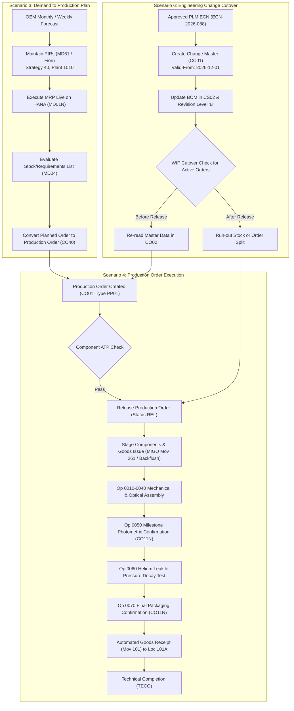

# Business Scenario Document (BSD)
## Integrated Production Planning, Shop Floor Execution, and Engineering Change Management in SAP S/4HANA

**Document Identifier:** `BSD-MFG-PP-PLM-001`  
**Author:** Adarsh (Target Role: SAP Manufacturing / Production Planning / PLM Functional Consultant)  
**Project:** SAP Manufacturing Coverage Project (Discrete Automotive Assembly)  
**Reference Release:** SAP S/4HANA 2023 / Cloud Private Edition  
**Status:** Approved v1.0 | **Date:** 2 November 2026  
**Linked PRD Deliverable:** Must-Have P0 Business Scenario Document (Covering Scenarios 3, 4, and 6)  

---

## 1. Document Control & Revision History

| Version | Date | Author | Reviewer / Approver | Change Summary |
| :--- | :--- | :--- | :--- | :--- |
| `0.1` | 2026-11-02 | Adarsh | Functional Lead | Initial Draft covering Scenarios 3, 4, and 6. |
| `1.0` | 2026-11-02 | Adarsh | Plant Operations & IT Steering Committee | Final Baseline Release for S/4HANA Manufacturing Implementation. |

---

## 2. Executive Summary & Business Context

In discrete automotive component manufacturing, operational profitability depends on tight synchronization between customer demand forecasts, shop floor assembly schedules, and dynamic engineering changes. Disconnections between these functions lead to inventory stockouts, line-side part shortages, scrap accumulation, and obsolete material cutover risks.

This Business Scenario Document (BSD) defines the end-to-end operational blueprint uniting **Demand Planning & MRP Live (Scenario 3)**, **Production Order Execution & Confirmation (Scenario 4)**, and **Engineering Change Cutover (Scenario 6)** within SAP S/4HANA. 

The reference product is the **Bi-LED Automotive Headlamp Assembly (`HL-200X`)**, manufactured in discrete assembly Plant `1010`.

---

## 3. Scope Definition

### 3.1 In-Scope Processes
1. **Demand to Production Plan (Scenario 3):**
   - Maintenance of monthly and weekly Planned Independent Requirements (PIRs) under Planning Strategy `40` (Planning with Final Assembly).
   - In-memory MRP Live execution (`MD01N`) calculating net requirements and generating multi-level planned orders and purchase requisitions.
   - Evaluation of the Stock/Requirements workbench (`MD04`) and planned order conversion.
2. **Production Order Execution and Confirmation (Scenario 4):**
   - Production order creation (`PP01`), dynamic ATP availability checking, and release controls (`REL`).
   - Line-side material staging and Goods Issue (Movement Type `261`) via automated backflushing and manual posting.
   - Shop floor operation milestone confirmations (`CO11N`), scrap tracking with mandatory reason codes, and automatic Goods Receipt (`101`).
   - Order technical completion (`TECO`) and costing variance settlement prerequisites.
3. **Engineering Change Management Cutover (Scenario 6):**
   - Incorporation of Engineering Change Master (`ECM`) records with Valid-From effectivity dates.
   - S/4HANA Production BOM version maintenance and Revision Level assignment (`CC11`).
   - In-flight Work-in-Process (WIP) order cutover governance (order master data re-read, order splitting, or material run-out).

### 3.2 Out-of-Scope
- Customer billing, sales order creation, and accounts receivable (covered in Sales & Distribution / SD).
- Vendor invoice verification and accounts payable ledger entries (covered in Financials / FI).
- Custom ABAP enhancements or side-by-side extensibility (standard S/4HANA out-of-the-box functionality is utilized).
- Human resources time evaluation and payroll calculation.

---

## 4. Business Assumptions & Prerequisites

1. **Enterprise Structure:** Plant `1010` (Automotive Discrete Manufacturing) is fully configured with Storage Locations `101A` (Finished Goods), `101B` (Sub-Assemblies), `101C` (Raw Materials & Fasteners), `101D` (Packaging), and `101Q` (Quality Quarantine).
2. **Master Data Integrity:** Material Masters, Multi-Level Bills of Material (Usage `1`), Work Centers, and Routings are validated, active, and costed (`CK24` standard cost estimate released).
3. **Shift & Factory Calendar:** Plant `1010` operates on a 5-day manufacturing calendar with 2 shifts per day (16 gross hours, 14.4 net productive capacity hours per work center).
4. **Discrete Execution Model:** Discrete production orders (`PP01`) are used rather than repetitive run schedules (`REM`) due to customer-specific serialization and engineering revision controls.

---

## 5. End-to-End Business Scenario Architecture

The diagram below illustrates the unbroken thread connecting forecasting, material requirements planning, shop floor assembly, quality milestones, and engineering change cutover.

---

## 6. Detailed Process Steps & Functional Roles

### Phase 1: Demand Management & MRP Live Execution (Scenario 3)
1. **Forecast Ingestion:** The Demand Planner enters planned demand into S/4HANA using Fiori App **Maintain PIRs** (`MD61`). Requirements type `VSF` is assigned.
2. **MRP Live Execution:** The MRP Controller triggers MRP Live (`MD01N`) at 02:00 AM daily. S/4HANA evaluates stock on hand, open purchase orders, safety stocks, and explodes the `HL-200X` BOM.
3. **Order Recommendation:** MRP creates Planned Orders (order type `LA`) for assembly `HL-200X` and Purchase Requisitions (type `NB`) for raw components.
4. **Shortage Monitoring:** The planner accesses Fiori App **Monitor Material Coverage** (`MD04`). Items with negative projected available quantities trigger immediate expediting actions.
5. **Planned Order Conversion:** The Production Scheduler converts planned orders into firm Production Orders using Fiori App **Manage Planned Orders** (`CO40`).

### Phase 2: Production Order Execution & Milestone Confirmation (Scenario 4)
1. **Order Creation & ATP Check:** Order type `PP01` is created for 100 units. The system conducts an ATP check across all 8 BOM components. If all components are confirmed, the order receives status `MACM` (Material committed).
2. **Order Release & Traveler Generation:** The Production Supervisor releases the order (`CO02`), advancing the status to `REL`. Barcoded shop traveler documents and container tags are generated.
3. **Component Staging & Consumption:**
   - **Manual Issue:** High-value Bi-LED modules (`HL-PCB-301`) are staged from `101B` via `MIGO` (Movement Type `261`) with serial number registration.
   - **Backflushing:** Consumable items (PUR adhesive `HL-ADH-501`, fasteners `HL-SCR-701`, gaskets `HL-GSK-601`) are consumed automatically upon operation confirmation.
4. **Milestone Confirmations:**
   - Milestone Operation `0050` (Photometric Inspection) is confirmed via Fiori App **Confirm Production Operation** (`CO11N`). Confirming this milestone automatically backflushes and confirms preceding operations `0010`, `0020`, `0030`, and `0040`.
   - Milestone Operation `0070` (Packaging) is confirmed upon final visual inspection and barcode labeling.
5. **Automatic Goods Receipt:** Confirmation of Operation `0070` triggers an automated Movement Type `101`, depositing 98 finished headlamps into Finished Goods storage location `101A` under status `DLV` (Delivered).
6. **Technical Completion:** The supervisor performs Technical Completion (`TECO`) in `CO02`, releasing residual component reservations and locking the order against further operational postings.

### Phase 3: Engineering Change Cutover & WIP Governance (Scenario 6)
1. **Change Master Activation:** The Engineering Change Coordinator creates Change Master `ECM-2026-088` in `CC01`, designating Valid-From Date `2026-12-01`.
2. **BOM Versioning:** The Master Data Engineer updates the `HL-200X` BOM under the Change Master in `CS02`. Component `HL-SCR-701` (M4x16) is flagged with Valid-To `2026-11-30`; component `HL-SCR-702` (M4x18) is introduced with Valid-From `2026-12-01`.
3. **Revision Level Assignment:** Revision Level `B` is assigned to `HL-200X` via `CC11`.
4. **WIP Order Cutover Rules:**
   - **Unreleased Orders (Status `CRTD`):** The planner executes `CO02` -> *Functions -> Read Master Data*. S/4HANA automatically pulls the new BOM revision and updates component reservations.
   - **Released Orders with No Confirmations (Status `REL`):** If physical staging has not begun, master data is re-read. Old screws are returned via `MIGO` Movement `262` (Reversal of Goods Issue).
   - **Partially Assembled Orders (Status `PCNF`):** Orders are completed under Revision `A`. Subsequent planned orders scheduled on or after `2026-12-01` strictly utilize Revision `B`.

---

## 7. Business Rules, Policies & System Controls

| Rule ID | Business Rule Statement | S/4HANA Enforcement Mechanism | Violation Impact |
| :--- | :--- | :--- | :--- |
| **BR-MFG-001** | Production orders cannot be released if critical components have missing stock. | Availability Check Control in `OPJK` set to "Release Block on Missing Parts". | Order remains in status `CRTD` with user status `MSPT` (Missing Part). Line cannot assemble. |
| **BR-MFG-002** | Milestone operations must be confirmed before downstream final receipt. | Operation Control Key `PP01` / `QM01` with Milestone Indicator checked in `CA02`. | Direct confirmation of Op 0070 fails if Op 0050 milestone is unconfirmed. |
| **BR-MFG-003** | Scrap exceeding 3.0% of batch quantity requires mandatory supervisor override and reason code. | Custom confirmation validation check / S/4HANA standard scrap tolerance profile. | System raises Error `RU 117` and blocks confirmation save until supervisor signs off. |
| **BR-MFG-004** | BOM modifications on active production items must reference an authorized Change Master. | S/4HANA Configuration: BOM Modification without Change Number prohibited for Plant `1010`. | Direct edits in `CS02` without Change Number `AENR` are disabled by authorization object `C_STUE_BER`. |
| **BR-MFG-005** | Components flagged for backflush must have an active storage location in BOM item or Material Master. | S/4HANA Material Master MRP 2 / BOM Item storage location check. | Movement `261` fails during confirmation, generating error record in Postprocessing COGI. |

---

## 8. Open Issues & Risk Management Log

| Issue ID | Category | Description | Business Impact | Mitigation / Action Plan | Owner | Target Date | Status |
| :--- | :--- | :--- | :--- | :--- | :--- | :--- | :--- |
| **OI-001** | Master Data | Storage location `101C` for consumable PUR adhesive requires temperature/shelf-life expiration control (SLED). | Adhesive past 6-month shelf life could cause seal voids and leak test failures. | Activate S/4HANA Batch Management and SLED check in Material Master Plant Data view. | Adarsh | 2026-11-10 | Open |
| **OI-002** | Execution | Backflush errors (COGI) caused by negative inventory when warehouse delays transfer postings from central stores. | Goods movements fail silently during `CO11N`, leading to distorted inventory balances. | Implement automated batch job `CORUPROC` / daily COGI clearing alert to supervisor Fiori inbox. | Adarsh | 2026-11-12 | In Progress |
| **OI-003** | ECM Cutover | Customer OEM build schedule may pull forward the cutover date by 10 days before supplier ships `HL-SCR-702`. | Line starvation if old screws are discontinued prematurely. | Maintain Discontinuation Indicator `1` with Parallel Runout in MRP 4 view to consume old inventory first. | Adarsh | 2026-11-15 | Resolved |
| **OI-004** | Integration | PLM CAD releases currently do not supply gross weights required for packaging calculations. | Master Data team must manually weigh finished units before shipping view maintenance. | Update PLM-to-ERP middleware mapping schema to calculate gross weight from component net sums. | Adarsh | 2026-11-18 | Open |
